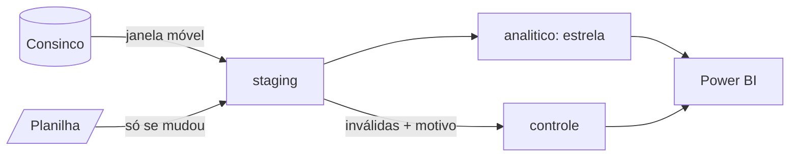

# Prevenção de Perdas — Índice de perda de Açougue e Hortifruti

Banco analítico que reúne **avarias identificadas** e **vendas** da Consinco com a
**perda não identificada** da planilha de inventário, atualiza-se sozinho todo dia
às 06h00 e alimenta um painel no Power BI.

> **Índice de perda** = (avaria identificada + perda não identificada) ÷ venda líquida
> da categoria na loja, no mês. Em regional e rede: soma das perdas ÷ soma das vendas.

| | |
|---|---|
| Período | setembro e outubro de 2026 (configurável) |
| Stack | PostgreSQL 16+ local · Python 3.11 a 3.14 · Power BI Desktop (Import) |
| Executar | `python etl.py` |
| Agendamento | Agendador de Tarefas do Windows, diário 06h00 (`agendamento/`) |

---

## 1. Como rodar, passo a passo

**Pré-requisitos:** PostgreSQL 14+ instalado localmente, **Python 3.11 a 3.14** (versões
mais novas ainda não têm pacote pronto do `oracledb` para Windows e exigem compilador C++),
acesso de **leitura** à Consinco (Oracle) e Power BI Desktop.

```bash
# 1. ambiente Python (Windows: py -3.14 escolhe a versão; Linux: python3 -m venv .venv)
py -3.14 -m venv .venv
.\.venv\Scripts\Activate.ps1        # se bloquear: Set-ExecutionPolicy -Scope CurrentUser RemoteSigned
python --version                   # confira a versão antes de instalar
pip install -r requirements.txt

# 2. credenciais e parâmetros (o .env não vai para o Git)
copy .env.example .env            # Linux: cp .env.example .env
#    preencha PG_*, ORACLE_*, CATEGORIAS_ESCOPO, NIVEL_CATEGORIA, CGOS_AVARIA

# 3. banco do zero: cria o banco, schemas, tabelas, índices e views (sql/ddl)
python criar_banco.py

# 4. coloque a planilha na pasta entrada/  (qualquer nome .xlsm/.xlsx)

# 5. carga inicial (fora do horário comercial: recarrega o período inteiro)
python etl.py --modo completo

# 6. agende a carga diária (Windows, uma vez)
powershell -ExecutionPolicy Bypass -File agendamento\registrar_tarefa_windows.ps1
```

Os parâmetros da Consinco (categorias, nível, CGOs, regional) foram descobertos com
`sql/extracao/00_descoberta.sql`, que só lê o dicionário de dados.

**Testar sem a produção:** com `CONSINCO_MODO=mock` no `.env`, o ETL lê dados
fictícios. `python tests/testar_processo.py` recria o banco e prova, com asserts,
idempotência, retroativos, nova versão da planilha, concorrência e falha controlada.

Opções úteis de `etl.py`: `--fontes planilha`, `--forcar-planilha`,
`--modo completo --inicio 2026-09-01 --fim 2026-09-30`, `--data-referencia AAAA-MM-DD`.
Códigos de saída: 0 sucesso · 1 parcial · 2 falha · 3 bloqueada (outra execução rodando).

## 2. Estrutura

```
├── etl.py                    ponto de entrada (um comando)
├── criar_banco.py            cria o banco do zero a partir de sql/ddl
├── relatorio_qualidade.py    gera a tabela de qualidade (seção 5) a partir do banco
├── sql/ddl/                  schemas, tabelas, índices, views, permissões
├── sql/extracao/             consultas na Consinco (descoberta, cadastros, avarias, vendas, conferência)
├── sql/analises/             01_indice_loja.sql, 02_indice_regional.sql, 03_perda_identificada_vs_nao.sql
├── etl/                      código: config, controle, trava, janela, qualidade, cargas, fontes
├── agendamento/              .bat + registro no Agendador do Windows; .sh + crontab (Linux)
├── powerbi/                  .pbix e roteiro de montagem com as medidas DAX
├── tests/                    gerador de dados fictícios e teste de ponta a ponta
└── docs/                     diagrama do modelo, prints
```

## 3. Modelo de dados

Diagrama completo em [docs/modelo.md](docs/modelo.md).



**Três schemas:** `staging` guarda os dados como vieram (auditoria e reprocesso sem
voltar à fonte); `analitico` é o modelo tratado que o Power BI lê; `controle`
registra execuções, cargas por fonte/arquivo/aba e linhas rejeitadas com motivo.

**Por que estrela com três fatos?** As três fontes têm grãos diferentes — avaria é
loja x produto x dia x CGO, venda é loja x categoria x dia, inventário é loja x
produto x data da contagem. Forçar tudo numa tabela só obrigaria a inventar produto
na venda ou perder o detalhe da avaria. Com fatos separados e dimensões
compartilhadas (loja, categoria, data), o Power BI combina os três pelo filtro e o
índice é calculado no grão comum, loja x categoria x mês
(`analitico.vw_indice_perda_mensal`).

**Decisões de modelagem:**
* **Chaves primárias naturais** em todos os fatos: são elas que garantem idempotência.
* `seq_categoria` gravado nos fatos: o índice por categoria não depende do produto
  (a venda nem tem produto).
* `fato_perda_inventario` guarda `vlr_divergente` com sinal (auditoria) e
  `vlr_falta` como coluna gerada pela regra de negócio — a regra fica no banco, uma vez só.
* `aba_origem` e `linha_origem` levam qualquer número do painel até a linha do Excel.
* Regional `-1 = SEM REGIONAL`: loja sem regional não some do total da rede.
* Papel `leitura_bi` somente leitura para o Power BI.

## 4. Extração da Consinco

| Consulta | Regras aplicadas |
|---|---|
| `01_lojas.sql` | Lojas e regional. **Provisório:** regional = UF da loja, porque nenhum cadastro de regional está preenchido na Consinco (investigação em `docs/descoberta_consinco.md`). Trocar a regional muda só esta consulta |
| `02_produtos.sql`, `03_produto_codigo.sql` | Só produtos de Açougue/Hortifruti; categoria pela família, **ligação ativa**, no nível configurado; EANs para o cruzamento |
| `04_avarias.sql` | CGOs de avaria marcados no ABC de movimentação; 403 só em local tipo T; 552 só em local tipo L; valor = NF + IPI + ICMS ST + despesas na NF + ISS + despesas fora − descontos fora; grão loja x produto x data x CGO |
| `05_vendas.sql` | Venda líquida por loja x categoria x dia com a lógica **do próprio relatório** ABC de Venda Sintético: base `MADMV_ABCDISTRIBPROD`, só operações que acumulam venda (`ACMCOMPRAVENDA IN ('S','I')`), venda líquida = `VLRITEM − VLRDEVOLITEM` |

**Escopo confirmado na Consinco (10/11/2026):**
* Categorias: `ACOUGUE = 11` e `HORTIFRUTI = 24`, nível 1, divisão 1 (VAREJO), árvore **Mix**
  (`TIPCATEGORIA = 'M'`). A família tem ligação ativa em três árvores (M, C e L); sem esse filtro a
  mesma venda seria contada até três vezes.
* CGOs de avaria (`INDFIXOABCMOVIMENTACAO = 'S'` e tipo `AS`): **549, 552, 562 e 563**, mais o **403**
  exigido pelo enunciado. O 563 (rendimento de produção) é exibido separado no painel, para a área
  decidir se entra na perda.
* Tipos de local: `T` = troca, `L` = loja. Daí a regra 403 só em `T` e 552 só em `L`.

**Cuidado com a produção:**
* filtro de data em **intervalo semiaberto sem função na coluna** (`col >= :ini AND col < :fim`): usa o índice e não perde o último dia quando a coluna tem hora;
* **blocos de 7 dias** por consulta e **bind variables**; `call_timeout` de 10 min;
* sessão identificada (`module = ETL_PREVENCAO_PERDAS`) para o DBA enxergar no `V$SESSION`;
* cadastros filtrados pelas categorias do escopo (não lê a tabela de produtos inteira);
* **horário comercial (06h30–22h30):** as lojas abrem das 07h às 22h, e a folga de 30 min cobre a abertura (sincronização do PDV, recebimento) e o fechamento (caixas e integração da venda). Nessa faixa a carga diária reduz a janela a 3 dias e a carga completa é recusada; a janela cheia roda às 06h00. A faixa é configurável no `.env`;
* `NVL` em cada parcela do valor: no Oracle `número + NULL = NULL`, e um imposto nulo zeraria a avaria inteira.

### Conferência com o ABC de Venda Sintético

A venda líquida tem que bater com a tela. A conferência é feita em três pontos, para o mesmo
período, loja e categoria: a tela, o Oracle (`sql/extracao/06_conferencia_abc.sql`) e o banco
(`sql/analises/00_conferencia_venda.sql`).

**1. Total da loja (valida a fórmula)**: loja 10, 08/11/2026, todas as categorias:

| Medida | Tela ABC | Oracle (lógica do ETL) | Diferença |
|---|---:|---:|---:|
| Produtos | 4.725 | 4.725 | 0 |
| Quantidade | 52.392,436 | 52.392,436 | 0,000 |
| Valor Total Liq (R$) | 352.775,08 | 352.775,08 | **0,00** |

**2. Por categoria (valida o vínculo com Açougue e Hortifruti)**: loja 10, 08/11/2026:

| Categoria | Tela ABC (R$) | Oracle `05_vendas.sql` (R$) | PostgreSQL após a carga (R$) | Diferença |
|---|---:|---:|---:|---:|
| Açougue (11) | 71.636,60 | 71.636,60 | 71.636,60 | **0,00** |
| Hortifruti (24) | 29.197,70 | 29.197,70 | 29.197,70 | **0,00** |

A soma das 11 categorias da tela (Detalhe 1 = Categoria) é o mesmo total da loja, R$ 352.775,08:
o vínculo família → categoria da árvore Mix não perde nem duplica venda.

**Atenção aos nomes:** na tela, "Valor Total" é a venda **antes do desconto** (Açougue R$ 71.715,31,
com desconto de R$ 78,71). No modelo, `vlr_venda_bruta` é a venda **antes da devolução**
(`VLRITEM`). O índice usa só a venda líquida, que é o "Valor Total Liq" da tela.

**3. Mês fechado (valida a carga até o banco)**: duas lojas x duas categorias x dois meses:

| Loja | Categoria | Mês | Tela ABC (R$) | Oracle (R$) | PostgreSQL (R$) | Diferença |
|---|---|---|---:|---:|---:|---:|
| 10 | Açougue | set/2026 | | | | |
| 10 | Hortifruti | set/2026 | | | | |
| 10 | Açougue | out/2026 | | | | |
| 10 | Hortifruti | out/2026 | | | | |
| ⚠️ 2ª loja | Açougue | set/2026 | | | | |
| | Hortifruti | set/2026 | | | | |
| | Açougue | out/2026 | | | | |
| | Hortifruti | out/2026 | | | | |

Os prints e exportações da tela ficam em `docs/conferencia/`, fora do Git (são dados reais de venda); o README guarda só os totais. As consultas de mês fechado rodam fora do horário
comercial.

**Como a lógica foi encontrada:** pelo SQL Monitor, a tela só grava parâmetros e lê o resultado de
uma tabela temporária de sessão (`MBIX_TABCSINTETICA`, GTT). O cálculo fica numa procedure no
servidor, e o usuário de leitura não enxerga o código dela (`ALL_SOURCE` vazio). Por isso a fórmula
não foi deduzida por tentativa: foi copiada do SQL que o próprio relatório mostra no botão **SQL**
(consulta 744454). O caminho completo está em `docs/descoberta_consinco.md`.

Parâmetros da tela: divisão 1; todos os segmentos (1 a 13); categoria mercadológica; **não**
subtrai ICMS ST; **não** subtrai verba de acordo do PDV.

## 5. Qualidade dos dados

Gerada com `python relatorio_qualidade.py` (os números saem do banco).

**Estrutura e conteúdo da planilha** (versão até setembro; contagens do próprio arquivo):

| # | Problema encontrado | Linhas / ocorrências | Tratamento |
|---|---|---:|---|
| 1 | 22 abas **ocultas** com nomes parecidos ("AÇOUGUE - JAN-25", "HORTI - MAI-25"...), histórico de 2025 em layout antigo | 22 abas | Ignoradas: só abas visíveis são lidas (preferência pela que tem Tabela do Excel). Lê-las duplicaria dados |
| 2 | Aba de Hortifruti chama **"HORTIFRUTE"** (grafia) | 1 aba | Nome comparado sem acento/caixa e por trecho ("HORTI") |
| 3 | Título "CONSOLIDADO 2025" com dados de **2026**; arquivo nomeado por mês | — | Nome do arquivo e título ignorados; vale a coluna de data e o hash do conteúdo |
| 4 | Cabeçalho na **linha 6**, com título mesclado (A1:R2) e quadro-resumo acima | 5 linhas | Cabeçalho localizado pelos nomes de coluna; título ignorado |
| 5 | Quadro-resumo e lista de lojas **soltos à direita** da tabela (colunas U–Z) | 24 linhas | Só colunas com cabeçalho na linha 6 são lidas |
| 6 | Milhares de **linhas vazias formatadas** abaixo da tabela | 13.278 (Aç.) / 49.643 (Ht.) | Ignoradas (não são registros) |
| 7 | **Observações soltas** na coluna S, muito abaixo da tabela, sem produto/loja/valor | 34 / 71 | Rejeitadas como `LINHA_SEM_DADOS` (registradas, não somem) |
| 8 | **Código de barras** misturando número e texto, e células com espaço `" "` | 554 / 2.716 texto | Normalizado para dígitos; espaço = vazio. Usado só como segunda chave (a 1ª é o PLU) |
| 9 | **Estoque do sistema negativo** (QTDE. CONGELADA < 0) | 168 / 1.264 | Carregado e sinalizado. Não gera falta (só sobra), então não infla a perda — mas indica erro de entrada/cadastro |
| 10 | Grafias diferentes: DIVISÃO "AÇOUGUE"/"ACOUGUE"; CICLO "2° CICLO"/"2º CICLO"/"2°CICLO"; nome da loja 17 "CATOL" (Aç.) x "CATOLE" (Ht.) | 474 / 1.703 | Não usados como chave: loja pelo **número**, categoria pela **Consinco** |
| 11 | Itens de granel **"Verdão"** na aba de Hortifrute (amendoim, castanha, damasco, temperos), que pela descrição parecem Mercearia | 317 linhas | **Mantidos.** Na Consinco estão em Hortifruti (categoria 24, árvore Mix), e a venda deles também cai em Hortifruti. A categoria vem sempre do cadastro, não da descrição: assim numerador e denominador do índice usam a mesma classificação |
| 12 | Sobras e divergência zero | 437+28 / 2.333+607 | Carregadas com `vlr_falta = 0` (regra: só faltas) |

**Conferências que passaram em 100% das linhas** (dão confiança no arquivo):
VALOR DIVERGENTE = VALOR CONTADO − VALOR CONGELADO; QTDE. DIVERG. = contagem − congelada;
STATUS coerente com o sinal; nenhuma duplicidade loja + PLU + data; nenhuma sobreposição entre as abas;
o número da loja sempre bate com o prefixo do nome ("005-HQ PATOS" = 5).

**Cruzamento com a Consinco** (carga de 10/11/2026, planilha até setembro):

| Verificação | Açougue | Hortifruti |
|---|---:|---:|
| Linhas lidas | 1.335 | 6.404 |
| Carregadas | 1.301 | 6.332 |
| `LINHA_SEM_DADOS` (observações soltas) | 34 | 71 |
| `PRODUTO_FORA_ESCOPO` (existe na Consinco, mas em outra categoria) | 0 | 1 |
| `PRODUTO_NAO_ENCONTRADO` / `LOJA_NAO_ENCONTRADA` | 0 | 0 |
| Aba x categoria da Consinco | 100% coerente | 100% coerente |
| Faltas (R$) | 565.845,27 | 576.625,74 |

Todo PLU da planilha foi encontrado na Consinco, e nenhum produto de uma aba pertence à
categoria da outra.

**Princípios adotados:**
* **Nada some sem registro:** toda linha lida termina carregada ou em
  `controle.rejeitado`, com a linha original (JSON), o nº da linha no Excel, o motivo
  e o detalhe. O processo confere `lidas = carregadas + rejeitadas` e falha se não fechar.
* **Não inventar dado:** valor em branco não vira zero, loja em branco não é
  "puxada" da linha de cima (exceto célula mesclada ou título de bloco explícito).
* **Corrigir o que é só formato** (texto "R$ -1.234,56", "(1.234,56)", data como
  texto ou número serial, código "0123"/"123.0"/EAN) e **rejeitar o que é conteúdo**.
* Motivo principal + todos os problemas da linha no detalhe: a área corrige tudo de uma vez.
* Produto sem par no escopo é diagnosticado na Consinco: *não existe* vs *existe em outra categoria*.

## 6. Carga diária e dados retroativos

**Consinco — janela móvel de 40 dias.** Todo dia o processo reextrai só os últimos
40 dias e **sincroniza essa janela**: insere o que é novo, atualiza só o que mudou
(`ON CONFLICT ... WHERE valores IS DISTINCT FROM`) e remove o que sumiu da fonte
(estorno/exclusão). Fora da janela nada é tocado. Tudo numa transação por fonte.

*Por que 40 dias:* cobre o mês corrente e o fechamento do mês anterior, quando se
concentram as correções retroativas. É um parâmetro (`JANELA_RETROATIVA_DIAS`).
*Por que não "só o que mudou" por data de alteração:* lançamentos podem ser
excluídos, e exclusão não deixa data de alteração; comparar a janela pega inclusão,
alteração e exclusão. Para correções mais antigas que 40 dias:
`python etl.py --modo completo --inicio ... --fim ...` (fora do horário comercial).

Proteções: primeira execução carrega desde `PERIODO_INICIO`; se a máquina ficar
desligada mais que a janela, a próxima execução começa do último dia carregado.

**Planilha — versão por conteúdo (SHA-256).** O processo pega a planilha mais recente
da pasta `entrada/` (ignora `~$` do Excel aberto), copia para um temporário e
calcula o hash. Hash igual ao da última carga bem-sucedida da aba → não reprocessa.
Hash diferente → a nova versão **substitui** os dados da aba anterior numa única
transação. Cada aba é independente: se uma vier quebrada, a outra carrega e a
quebrada mantém a versão anterior.

**Idempotência:** chave natural + upsert + substituição por janela/aba. Rodar duas
vezes seguidas dá `+0 ~0 -0` (provado em `tests/testar_processo.py`).

**Concorrência:** advisory lock do PostgreSQL no início. A segunda execução registra
`BLOQUEADA` e sai sem tocar em nada. Se o processo morrer, a conexão cai e a trava
some sozinha (sem arquivo `.lock` órfão). No Windows, a tarefa ainda usa
`MultipleInstances = IgnoreNew`.

**Falha controlada:** cada fonte em `try` próprio e transação própria. Consinco fora
do ar → fontes da Consinco ficam `FALHA`, a planilha é carregada com os cadastros
da última carga, a execução termina `SUCESSO_PARCIAL` (código 1).

**Onde roda:** ⚠️ PREENCHER (ex.: no meu notebook com Windows 11, Agendador de
Tarefas, usuário local). Em produção: servidor da empresa sempre ligado, com a
mesma tarefa. Logs em `logs/etl_AAAA-MM-DD.log` e `logs/agendado_AAAA-MM-DD.log`.

## 7. Power BI

Conectado direto ao PostgreSQL, modo **Import** (volume pequeno, dado muda 1x/dia,
DAX completo e rápido). Medidas, relacionamentos e páginas em
[powerbi/MONTAGEM_DO_PAINEL.md](powerbi/MONTAGEM_DO_PAINEL.md).

## 8. Análises em SQL

| Arquivo | Pergunta |
|---|---|
| `sql/analises/01_indice_loja.sql` | Índice por loja, categoria e mês; variação set→out em p.p. |
| `sql/analises/02_indice_regional.sql` | Índice por regional e rede, por categoria (razão das somas, `GROUPING SETS`) |
| `sql/analises/03_perda_identificada_vs_nao.sql` | Identificada x não identificada por loja; lojas acima de 70% não identificada |

## 9. Decisões e suposições

| # | Ponto ambíguo | Decisão | Por quê |
|---|---|---|---|
| 1 | CGOs de avaria além de 403/552 | Entram em qualquer tipo de local; a lista está em `CGOS_AVARIA` | A regra de local foi dada só para 403 e 552 |
| 2 | Categoria da planilha x Consinco divergem | Vale a da Consinco; contado em avisos | Mesma régua de avaria e venda; senão o índice mistura classificações |
| 3 | Sobras (divergência positiva) | Carregadas com `vlr_falta = 0` | Regra: só faltas; manter a sobra preserva auditoria |
| 4 | Mesma loja/produto/data com valores diferentes | Rejeita todas (configurável: somar) | Não há como saber qual vale; somar poderia dobrar perda |
| 5 | Linhas fora do período | Rejeitadas como `FORA_DO_PERIODO` (regra de negócio) | Nada some sem registro; o painel separa por tipo de motivo |
| 6 | Linhas ocultas na planilha | Lidas | Dado oculto continua sendo dado; ocultar é formatação |
| 7 | Venda sem produto | Fato de venda no grão loja x categoria x dia | É o grão do ABC Sintético e o do índice |
| 8 | Índice agregado | Razão das somas, nunca média de índices | Pondera pela venda |
| 9 | Nome do arquivo: o enunciado cita "…Rotativo 2025.xlsm", o recebido é "…Rotativo Setembro.xlsm" e o título interno diz "2025" com dados de 2026 | Irrelevante: vale o conteúdo (hash) e o padrão `*.xls[xm]` | O nome muda a cada versão; o processo não pode depender dele |
| 10 | O que é "CÓDIGO PLU" | É o **SEQPRODUTO** da Consinco; "CÓDIGO BARRAS" é segunda opção | Na aba `ARQUIVO` (extração da Consinco dentro da planilha), ~87% dos PLU existem como SEQPRODUTO com a mesma descrição |
| 11 | Aba `ARQUIVO` (cadastro dentro da planilha) | Não é usada como cadastro | Está desatualizada (faltam os produtos mais novos); a fonte da verdade é a Consinco |
| 12 | Nova versão da planilha sem algum mês antigo | Substitui só os **meses presentes** no arquivo novo; mês ausente é mantido e avisado no log | A planilha pede "não delete, apenas atualize"; uma versão só com outubro não pode apagar setembro |
| 13 | Faltas e sobras de produtos "similares" (coluna OBSERVAÇÕES: "similar 27544") | Não compensadas | Regra do enunciado: só faltas. Ver recomendação no resumo |
| 14 | ⚠️ PREENCHER | | |

## 10. Resumo para a gerência de Prevenção de Perdas

⚠️ PREENCHER com os números reais (até meia página). Estrutura:

**Período:** setembro e outubro de 2026 · Açougue e Hortifruti · N lojas.

1. **Onde está a perda.** O índice da rede foi X% em Açougue e Y% em Hortifruti; a
   regional Z concentra W% da perda total com V% da venda.
2. **O que piorou.** De setembro para outubro, as lojas A e B pioraram +n p.p. em
   [categoria] — juntas respondem por R$ … de perda adicional.
3. **O que não estamos vendo.** Em N lojas, mais de 70% da perda é não identificada
   (aparece só no inventário). Nelas, a perda acontece sem registro de avaria.

**Recomendação:** começar pelas N lojas com perda não identificada acima de 70%:
inventário rotativo semanal dos 20 itens de maior divergência e conferência do
lançamento de avaria (CGO correto, no dia) por 4 semanas; meta de trazer a parcela
não identificada para abaixo de 50% e medir o efeito neste mesmo painel.
